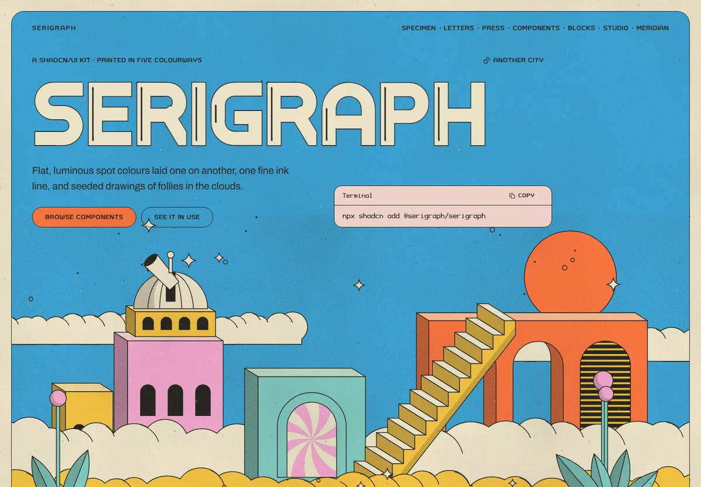

# Serigraph

A shadcn/ui component library, website and three typefaces in the style of a late-1970s silkscreen gig poster drawn with a technical pen: flat, luminous spot colours laid on one another, one fine ink line, weightless surreal architecture rising out of cloud banks, and wide round lettering with a line inside each stem. Themes are colourways: the same print with its colours rotated.



**Status:** in a repair pass before v0.1: the maintainer found the site laggy and several screens unfinished, so the release and its deployment are held ([plan](docs/plan.md)). Every shadcn/ui part on Base UI with shadcn's names, props and `data-slot`s, nine parts of Serigraph's own, seven blocks, Follies (seeded drawings of architecture in the clouds), three fonts of our own, a colourway studio and Meridian, a demo observatory built only from the kit: 88 registry items.

## What is in it

- **Colourways**: Sky, Pistachio, Coral, Marigold and Night, each a mapping of ten spot colours to roles (canvas, planes, action, highlight, clouds, four tones and the drawings' roles). Everything is colour on colour; cream is only the mat, display lettering and cloud highlights. The [studio](src/pages/studio.astro) makes new ones and exports their CSS.
- **Poster mode**: the canvas in a rounded frame inside a paper mat, or (off) running to the window's edges. With the line (1.5 or 1 px) and the printed grain, it is part of the appearance, saved per visitor and set before the first paint.
- **Components**: every shadcn part, printed flat: pills in spot colours inside one ink line, fields tinted from the surface beneath, the highlight for what is chosen, a short contour line under the pointer, pinwheel thumbs that roll, tabs drawn as archways, dialogs over a fine stipple screen, charts whose series differ by fill (flat, stipple, louvers, tint).
- **Extras**: a ticket stub, a programme list, a poster card, a date with a raised ordinal, a stair stepper, a cloud band, an arch frame, a medallion and a colourway switcher.
- **Blocks**: hero, sign-in, dashboard, settings, pricing, article and empty states.
- **Follies**: `folly({ template, seed })` draws a city, a window, a medallion, a band, an arcade wall or a doorway as SVG, framework-free and the same on a server, at build time and in the browser; `<Folly>` renders one and every fill is a colourway role, so it reprints in every colourway. `<Motif>` draws a pinwheel, a sparkle, a cloud or an archway on its own.
- **Our own letters**: Serigraph Display (wide, round, set in paper inside an ink outline with Serigraph Display Inline over it, through `<Lettering>`), Serigraph Sans (extended capitals, Regular and Bold, with raised ordinals) and Serigraph Mono, all built in this repository from one skeleton alphabet and embedded in the kit's stylesheet. OTF and WOFF2 files are in [`public/fonts`](public/fonts). MIT.

## Install

Serigraph installs with the shadcn CLI from its own registry into your project's `src/serigraph`, where it is yours to change. The registry is generated from the source (`npm run registry` writes `registry.json` and `public/r/`) and served by the site at `/r/{name}.json`. Until the site is public, serve it from a checkout (`npm run dev`) and point `components.json` at it:

```json
{
  "registries": {
    "@serigraph": "http://127.0.0.1:4801/r/{name}.json"
  }
}
```

Then add everything, or one part at a time:

```sh
npx shadcn add @serigraph/serigraph
```

```sh
npx shadcn add @serigraph/tabs @serigraph/folly
```

Make `src/serigraph/styles/serigraph.css` your Tailwind entry (`@import "./serigraph/styles/serigraph.css";`) and run `appearanceScript()` from `@/serigraph/theme/appearance-script` in the document head before paint, so the colourway, poster mode, line and grain are right on the first frame. Wrap a page in a surface (`canvas`, `ground`, `plane`): surfaces set the text, edge and fill that the parts inside read. The install contract is tested: `npm run test:consumer` installs items offline into a fresh Vite app and a Next.js App Router app whose page is a server component, and type-checks and builds both.

## Run the site

Requires Node.js 24 and npm 11.

```sh
npm ci
```

```sh
npm run dev
```

Open `http://127.0.0.1:4801`. Checks: `typecheck`, `lint`, `format:check`, `build`, `test:seeds` (every Follies template and motif against its snapshot), `check:contrast` (every text pair in every colourway, with the grain composited in), `registry:check` and `test:consumer`. `npm run build:textures` regenerates the grain; `npm run build:fonts` rebuilds the fonts from the skeleton alphabet. The build draws a share image for every page.

The static prototype the style was agreed on stays in `specimen/`:

```sh
python -m http.server 4803 --bind 127.0.0.1
```

Then open `http://127.0.0.1:4803/specimen/`.

## Documents

| Document                                             | What it owns                                                                      |
| ---------------------------------------------------- | --------------------------------------------------------------------------------- |
| [Plan](docs/plan.md)                                 | Goals, decisions, phases, progress, risks, open questions                         |
| [Style brief](docs/style.md)                         | The style's rules, colour, colourways, interface, type and space, letters, motifs |
| [Primitives](docs/primitives.md)                     | How each shadcn part, extra and block is treated in this style                    |
| [Accessibility review](docs/accessibility-review.md) | What v0.1 was checked for, what was fixed and what remains                        |
| [Quality](docs/quality.md)                           | Performance budgets, the lab profile and what was measured                        |
| [Changelog](CHANGELOG.md)                            | What each phase shipped                                                           |
| [AGENTS.md](AGENTS.md)                               | Working instructions for coding agents                                            |

Serigraph repeats [Fineliner](https://github.com/ossianravn/naive-indie-line)'s logic, which repeated [Patina UI](https://github.com/ossianravn/patina-ui)'s, in a new style.

## License

Code, art, fonts and generated textures: [MIT](LICENSE). Archivo, the reading face, is under the SIL Open Font License, shipped with its Fontsource package.
