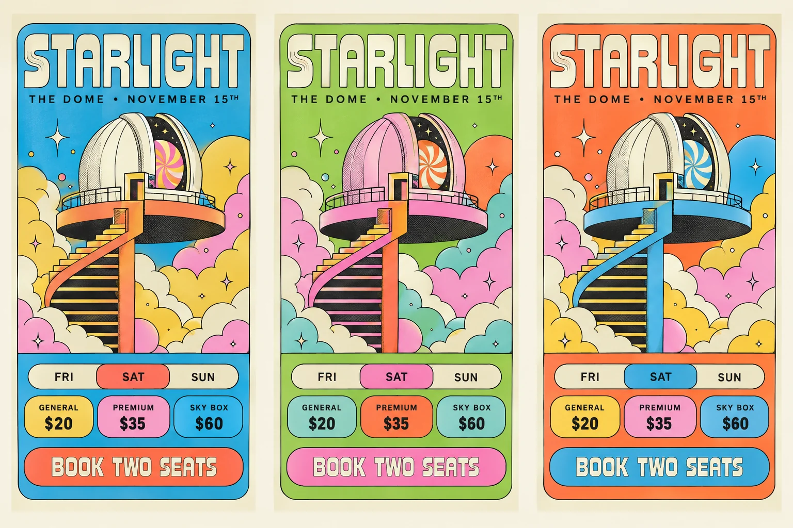

# Serigraph

A shadcn/ui component library, website and three typefaces in the style of a late-1970s silkscreen gig poster drawn with a technical pen: flat, luminous spot colours laid on one another, one fine ink line, weightless surreal architecture rising out of cloud banks, and wide round lettering with a line inside each stem. Themes are colourways: the same print with its colours rotated.



**Status:** Phase 0, foundations, done; Phase 1, our own letters, next. The kit has its tokens, five colourways, the printed grain, the surfaces and marks, and the appearance runtime; the site's first page is the foundations specimen. Components, Follies and the fonts follow ([plan](docs/plan.md)). The image above is a generated exploration, for direction only.

## Run the site

Requires Node.js 24 and npm 11.

```sh
npm ci
```

```sh
npm run dev
```

Open `http://127.0.0.1:4801`. Checks: `typecheck`, `lint`, `format:check`, `build`, and `check:contrast` (every text pair in every colourway, with the grain composited in). `npm run build:textures` regenerates the grain.

The static prototype the style was agreed on stays in `specimen/`, with the lettering prototype, Follies and the interface sampler:

```sh
python -m http.server 4803 --bind 127.0.0.1
```

Then open `http://127.0.0.1:4803/specimen/`.

## Documents

| Document                     | What it owns                                                                      |
| ---------------------------- | --------------------------------------------------------------------------------- |
| [Plan](docs/plan.md)         | Goals, decisions, phases, progress, risks, open questions                         |
| [Style brief](docs/style.md) | The style's rules, colour, colourways, interface, type and space, letters, motifs |
| [Changelog](CHANGELOG.md)    | What each phase shipped                                                           |
| [AGENTS.md](AGENTS.md)       | Working instructions for coding agents                                            |

Serigraph repeats [Fineliner](https://github.com/ossianravn/naive-indie-line)'s logic, which repeated [Patina UI](https://github.com/ossianravn/patina-ui)'s, in a new style.

## License

Code, art and generated textures: [MIT](LICENSE). The stand-in fonts (Archivo, Martian Mono) are under the SIL Open Font License, shipped with their Fontsource packages.
